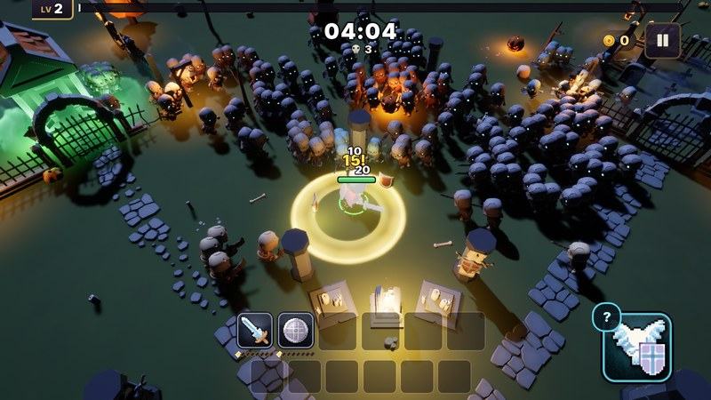
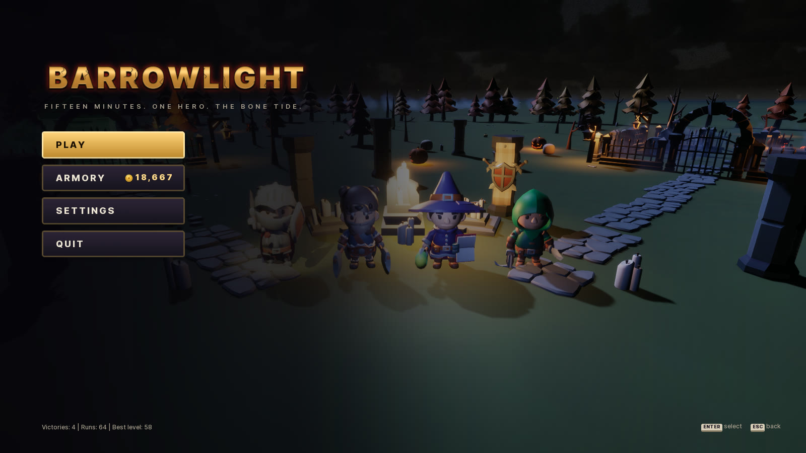
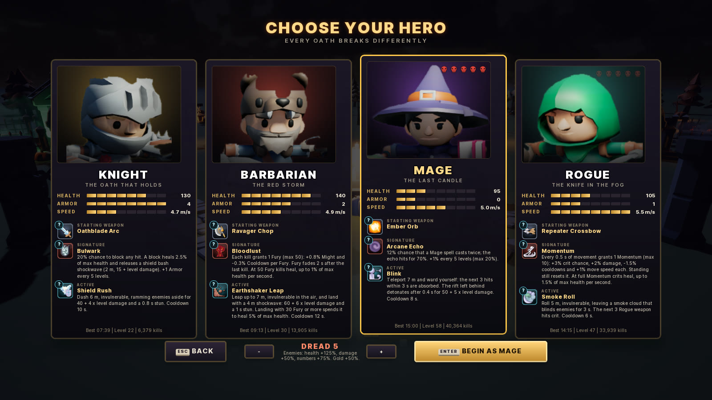
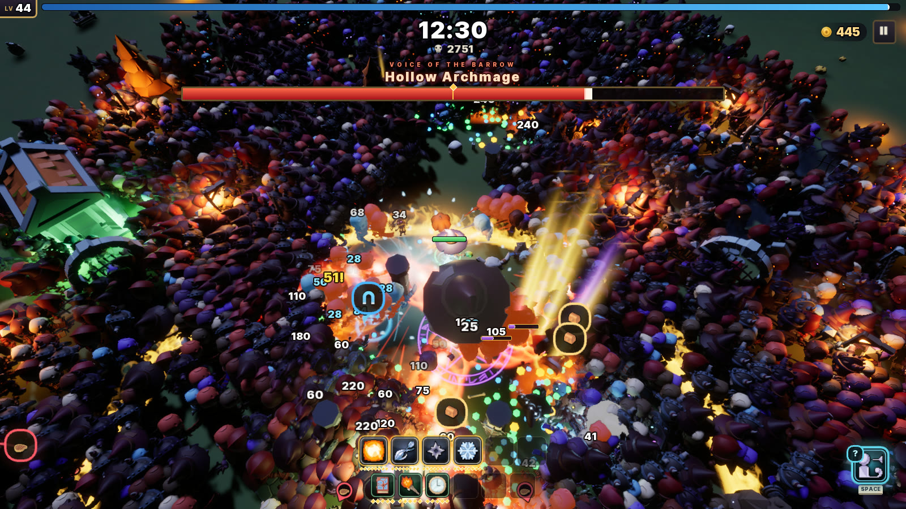
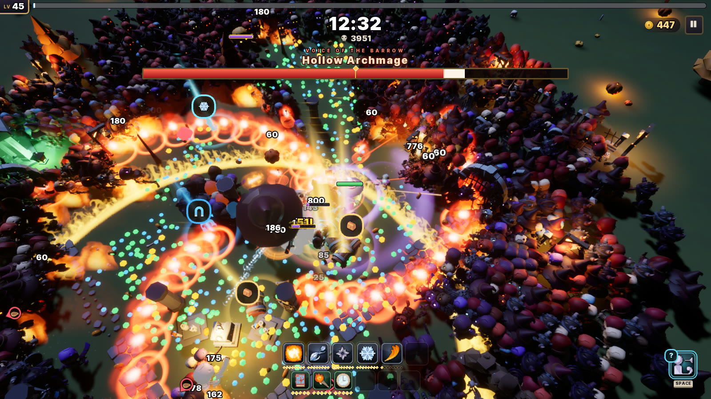
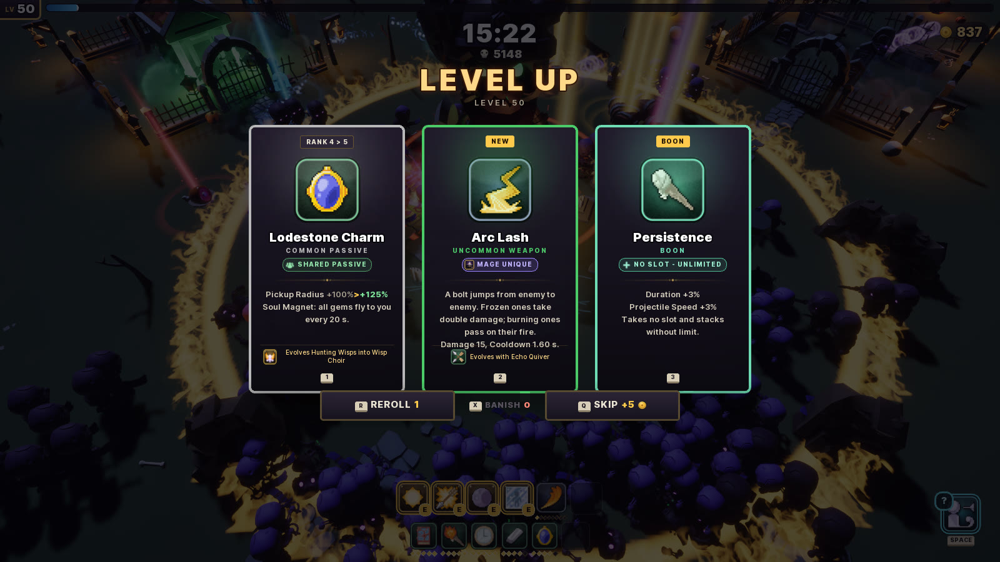
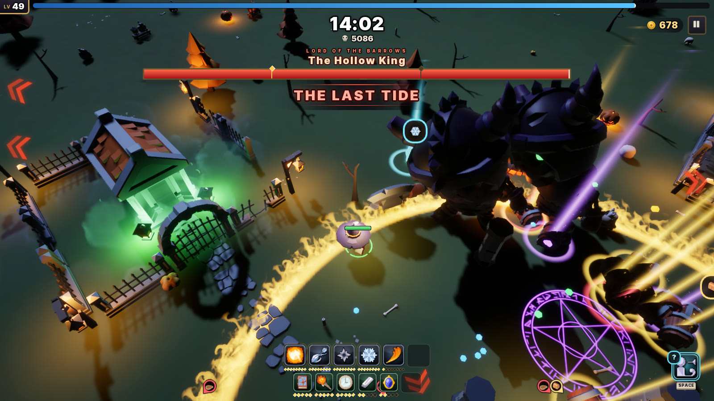

# Barrowlight

A complete survivors-style game: fifteen minutes on a haunted moor, one hero against the bone tide. Pick a class,
move, and let your weapons fire on their own; every level offers three random upgrades. Survive two mini-bosses and
kill the Hollow King at 14:00 to win. A sample project for
[Unravel Engine](https://github.com/unravel-dev/UnravelEngine).

The sample is built to show the engine's scripting, rendering and tooling under real load: thousands of animated
enemies drawn as instances, simulated in parallel in C#, with the particles, UI, audio and save data of a finished
game.

## Play

Clone this repository, or get it from the Samples page of the Unravel editor's start page, and open its folder in
the editor. Open `data/Scenes/Barrowlight.spfb` and press Play.

| Action | Keyboard and mouse | Gamepad | Touch |
|---|---|---|---|
| Move | WASD / arrows | Left stick | On-screen stick |
| Class active ability | Space | South / Right shoulder | Skill button |
| Pause | Escape / P | Start | Pause button |
| Menus | Mouse, arrows, Enter, Escape | D-pad, South, East | Tap |
| Level-up: pick, reroll, banish, skip | 1-3, R, X, Q | South, North, West, Back | Tap |

The sample ships with `Unlock All Heroes` on (Run entity), so every class can be tried at once; turn it off to play
the unlock path.

## What it shows

### The game

- **Four heroes**, each with a starting weapon, a signature passive and an active ability:
  - Knight, "The Oath That Holds": Oathblade Arc, Bulwark (blocks release a shield bash), Shield Rush.
  - Barbarian, "The Red Storm": Ravager Chop, Bloodlust (Fury from kills), Earthshaker Leap.
  - Mage, "The Last Candle": Ember Orb, Arcane Echo (spells cast twice), Blink.
  - Rogue, "The Knife in the Fog": Repeater Crossbow, Momentum (crit from movement), Smoke Roll.
- **27 weapons and 12 passives**, six slots each, with evolutions, chests, rerolls, banishes and skips. Each class
  has five weapons of its own beside the shared ones; every passive carries a trait and strengthens the evolution it
  unlocks with every rank.
- **13 boons**: small stat upgrades without a slot that can be taken again and again, each pick worth a little less.
- **Map events** between the waves: hold a Shrine of Vigil, chase a Grave Robber, break the Bone Pyres, or drink from
  a Moonwell while the dead close in.
- **Six skeleton archetypes in four tiers**: melee Shamblers, Grave Runners and Shieldbearers, ranged Bone Archers,
  exploding Cinder Skulls and Hex Casters that summon and ward. Elites carry affixes (Hasted, Splitter, Warded).
- **Bosses**: the Gravewarden at 5:00, the Hollow Archmage at 10:00 and the Hollow King at 14:00 (three phases,
  enrage at 16:30).
- **Meta progression**: gold buys permanent ranks in the Armory; boss kills unlock heroes (Gravewarden: Barbarian,
  Archmage: Rogue, level 20: Mage). After the first victory, Dread 1-5 makes the tide harder per level (enemies and
  bosses +25% health, +10% damage, +15% numbers) and pays +10% gold per level.
- **Settings**: volumes, screen shake, damage numbers, effects opacity, elite health bars and the touch stick side.
  The save lives in `Application.persistentDataPath/barrowlight_save.json`.

### The engine under it

- **Script-side hordes**: enemies are structure-of-arrays rows stepped with `Parallel.For` and a spatial hash grid,
  drawn with `Graphics.DrawMeshInstanced` per type and look, with baked skeletal animation clips (`BakedAnimation`),
  shadows and motion vectors.
- **Material instances** for per-look tints (elite, burning, frozen, hit flash) and the hero's glow.
- **Particle emitters** placed once in the scene and fired with `EmitParams` (position, velocity, color, size,
  lifetime): about 140 named effects serve every hit, telegraph and spell.
- **RmlUi documents** with data bindings for every screen, world-anchored markers and bars.
- **Audio buses** (music, effects, UI) with ducking and per-sound voice budgets.
- **Touch controls** through the engine's `SampleTouchJoystick` and virtual gamepad.

## Screenshots

| | |
|---|---|
|  |  |
|  |  |
|  |  |

## Project layout

| Path | What it holds |
|---|---|
| `data/Scenes/Barrowlight.spfb` | The game: the moor, the Run entity and every effect emitter. `Sandbox.spfb` is a test scene. |
| `data/Scripts/Core` | `Run`, the composition root and phase machine (`Run.Frame.cs` is the frame, `Run.Dev.cs` the test hooks); `GameClock` (the only writer of the time scale), progression, the run record, stats, the arena ground, the menu stage |
| `data/Scripts/Hero` | `HeroController` (movement, damage, healing), the hero's ring and light, the touch controls |
| `data/Scripts/Enemies` | `EnemyWorld` (every enemy as rows; split by concern into partial files), `EnemyCatalog`, `WaveDirector`, grave lanterns, abilities |
| `data/Scripts/Bosses` | `BossManager`, the three bosses (per-boss data as virtual properties on `Boss`), hazards and effects |
| `data/Scripts/Weapons` | Data-driven weapons (each catalog entry names its class), passives and boons, class kits, the loadout and level-up offers; `Framework` holds the shared weapon machinery (strikes, ground zones, lightning, enemy tables) |
| `data/Scripts/Combat` | Damage, crits and knockback; `ProjectileWorld` for hero and enemy projectiles |
| `data/Scripts/Pickups` | Gems, gold, food, magnets and chests as rows, drawn as instances; drops and chest beacons |
| `data/Scripts/Events` | Map events: their scheduler, rules, looks and tracker |
| `data/Scripts/Fx` | Particle effects by name, sounds with voice limits, hit stop, shake, camera rig |
| `data/Scripts/UI`, `data/Scripts/Meta` | RmlUi screens (`data/UI`; `UIScreen` documents the conventions for a new screen), the overlay widgets, damage numbers, save data, the Armory |
| `data/Scripts/Audio` | Sound catalog and the music player |
| `data/Scripts/Dev` | The test autopilot the balance tools drive (not used in normal play) |

Adding content:

- **A weapon**: one catalog entry (`WeaponCatalog` or a class's `<Class>Catalog.cs`) with its 8 rank rows, evolution
  and `create` function, plus its behaviour class deriving from `Weapon`. The catalog is validated at startup.
- **A passive or boon**: a catalog entry; passive traits live in `PassiveTraits`.
- **A hero class**: a `HeroClassDef` in `HeroCatalog` (stats, texts, start weapon, kit), a `ClassKit` subclass, its
  prefab on the Run entity and its weapons.
- **A map event**: a `MapEvent` subclass in `Events/` and one case in `MapEvents`.
- **A screen**: a `UIScreen` subclass with its `.rhtml` / `.rcss`, registered in `GameUI`.

## How it was built

The scene, prefabs, effects and materials were assembled through the editor's MCP tools by Python scripts kept
outside this repository; the same scripts ran balance simulations and screenshot reviews against the open editor,
driving the autopilot in `data/Scripts/Dev`.

## Platforms

| Profile | Notes |
|---|---|
| Desktop | Windows or Linux, as the editor runs on. |
| Android | Phones and tablets, with the on-screen stick and buttons. |

Deploy from the editor's Deploy window with a profile from `profiles/`.

## Credits

All third-party assets are CC0 1.0 (public domain) unless noted; credits are listed as a courtesy.

| Asset | Author | License | Source |
|---|---|---|---|
| KayKit Character Pack: Adventurers, Skeletons | Kay Lousberg | CC0 1.0 | https://kaylousberg.itch.io |
| KayKit Dungeon Remastered, Halloween Bits | Kay Lousberg | CC0 1.0 | https://github.com/KayKit-Game-Assets |
| Particle Pack, Smoke Particles | Kenney | CC0 1.0 | https://kenney.nl |
| Impact, Interface, Sci-fi Sounds, RPG Audio, Music Jingles | Kenney | CC0 1.0 | https://kenney.nl |
| 80 CC0 RPG SFX | rubberduck | CC0 1.0 | https://opengameart.org/content/80-cc0-rpg-sfx |
| RPG Sound Pack, Swishes Sound Pack | artisticdude | CC0 1.0 | https://opengameart.org/content/rpg-sound-pack |
| Deep Bone Crack/Break SFX | Zane Little Music | CC0 1.0 | https://opengameart.org/content/deep-bone-crackbreak-sfx |
| Bones rattle | congusbongus | CC0 1.0 | https://opengameart.org/content/bones-rattle |
| Gem collect SFX | Bobjt | CC0 1.0 | https://opengameart.org/content/gem-collect-sfx |
| Level up, power up, Coin get | wobbleboxx | CC0 1.0 | https://opengameart.org/content/level-up-power-up-coin-get-13-sounds |
| Determined Pursuit (battle music) | Emma_MA | CC0 1.0 | https://opengameart.org/content/determined-pursuit-epic-orchestra-loop |
| Heavy Boss Battle 1 (boss music) | MintoDog | CC0 1.0 | https://opengameart.org/content/heavy-boss-battle-1 |
| Dark Shrine Loop (menu music) | qubodup | CC0 1.0 | https://opengameart.org/content/dark-shrine-loop |
| Inter typeface | Rasmus Andersson | SIL Open Font License 1.1 | `data/UI/Fonts/Inter-OFL.txt` |

Generated textures, telegraph decals and many sound layers were made for this sample. Code and all other content are
under the MIT license in [LICENSE](LICENSE).
